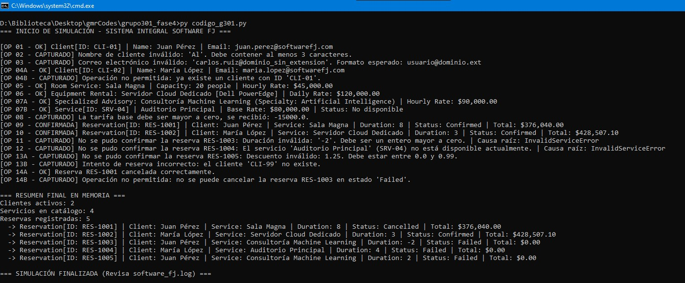
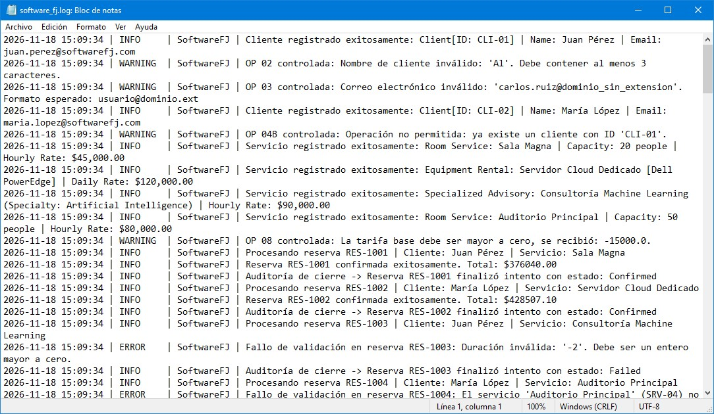

# Sistema Integral de Gestión de Clientes, Servicios y Reservas — Software FJ

**Asignatura:** Programación — Código 2013023  
**Grupo:** 301  
**Integrantes:** Alith Rodríguez, Germán Riveros

---

## 📋 Descripción del Proyecto

Este proyecto consiste en el desarrollo de un sistema robusto orientado a objetos diseñado para la empresa **Software FJ**, encargada de la oferta de servicios tecnológicos como la reserva de salas, alquiler de equipos de cómputo y asesorías especializadas.

El sistema gestiona en memoria el registro de clientes, catálogo de servicios y procesamiento de reservas sin depender de motores de bases de datos externas. Toda la gestión se apoya en conceptos avanzados de **Programación Orientada a Objetos (POO)**, manejo estructurado de **excepciones personalizadas** y **auditoría continua en archivos de registro (_logs_)**.

---

## 🛠️ Arquitectura y Principios de POO Aplicados

La solución fue construida sobre un único archivo fuente modularizado internamente para cumplir con las exigencias del proyecto, integrando los siguientes pilares:

### 1. Abstracción y Encapsulación

- **`BaseEntity` (Clase Abstracta Base):** Define la estructura fundamental de cualquier entidad identificable del sistema, asegurando identificadores únicos e inmutables mediante propiedades de solo lectura (`entity_id`).
- **`Client`:** Encapsula la información personal del cliente. Implementa _setters_ con expresiones regulares (`re`) para garantizar correos electrónicos válidos y nombres de al menos 3 caracteres reales.
- **`SoftwareFJSystem`:** Clase gestora (_Facade / Repository_) que encapsula las listas internas en memoria (`_clients`, `_services`, `_reservations`). Expone únicamente copias superficiales (`list()`) para evitar mutaciones externas indebidas.

### 2. Herencia y Polimorfismo

- **`Service` (Clase Abstracta de Dominio):** Define la interfaz común para el catálogo comercial con el método abstracto `calculate_cost(...)` y `get_description()`.
- **Servicios Especializados:**
  - **`RoomService`:** Aplica descuentos automáticos adicionales (5%) por reservas extensas (≥ 8 horas) y recargos por logística/montaje.
  - **`EquipmentService`:** Incluye una póliza de seguro obligatoria calculada por cada día de alquiler.
  - **`AdvisoryService`:** Permite recargos adicionales por viáticos o entregables especiales del consultor.
- **Polimorfismo:** La clase `Reservation` procesa el cobro invocado directamente en la interfaz `Service` sin recurrir a comprobaciones de tipo de subclase (`isinstance`).

### 3. Métodos Sobrecargados

- Se utiliza el decorador `@overload` del módulo `typing` para proveer múltiples firmas de cálculo de costos (duración simple, con impuesto, con descuento o con cargos adicionales), unificadas en una sola implementación concreta resiliente.

### 4. Manejo Avanzado de Excepciones y Trazabilidad

- **Jerarquía Personalizada:** Todas las excepciones derivan de `SoftwareFJError` (`InvalidClientError`, `InvalidServiceError`, `ReservationError`, `InvalidEntityError`).
- **Flujo `try / except / else / finally`:** El método `process()` de `Reservation` garantiza transiciones de estado seguras (`PENDING` ➔ `CONFIRMED` / `FAILED`), aislando fallos de validación o cálculo.
- **Encadenamiento (`raise ... from ...`):** Preserva la causa raíz de los errores al relanzar excepciones de negocio.
- **Auditoría por Logs:** Se utiliza el módulo estándar `logging` configurado en `software_fj.log` en formato UTF-8 para registrar tanto eventos operativos (`INFO`) como advertencias (`WARNING`) y errores críticos (`CRITICAL`).

---

## 📁 Estructura del Archivo Fuente

```text
.
├── codigo_g301.py       # Archivo fuente principal (Contiene todo el sistema y la simulación)
├── software_fj.log      # Archivo de auditoría generado automáticamente en ejecución
└── README.md            # Documentación del proyecto
```

---

## 🚀 Requisitos y Ejecución

### Requisitos Previos

- Python 3.8 o superior instalado en el sistema.

### Instrucciones de Ejecución

1. Clonar el repositorio o descargar el archivo `codigo_g301.py`.
2. Abrir una terminal en el directorio del proyecto.
3. Ejecutar el script fuente:

```bash
python3 codigo_g301.py
```

4. Para verificar la compilación sin ejecutar la simulación:

```bash
python3 -m py_compile codigo_g301.py
```

5. Inspeccionar el archivo de registro generado:

```bash
cat software_fj.log
```

---

## 📊 Cobertura de la Simulación (14 Operaciones)

El programa ejecuta de manera automatizada 14 operaciones completas sin interrupciones del proceso principal:

| Operación | Tipo / Evento                                                            | Estado Esperado                            |
| :-------- | :----------------------------------------------------------------------- | :----------------------------------------- |
| **OP 01** | Registro válido de cliente 1                                             | ✅ Éxito (`Client[CLI-01]`)                |
| **OP 02** | Registro de cliente con nombre corto (`<3` caracteres)                   | ⚠️ Capturado (`InvalidClientError`)        |
| **OP 03** | Registro de cliente con correo malformado                                | ⚠️ Capturado (`InvalidClientError`)        |
| **OP 04** | Registro válido de cliente 2 e intento con ID duplicado                  | ⚠️ Capturado (`InvalidClientError`)        |
| **OP 05** | Creación de servicio de Sala Magna (Capacidad 20)                        | ✅ Éxito (`RoomService`)                   |
| **OP 06** | Creación de servicio de Servidor Cloud Dedicado                          | ✅ Éxito (`EquipmentService`)              |
| **OP 07** | Creación de Asesoría ML y Sala Inhabilitada                              | ✅ Éxito (Disponibilidad `False`)          |
| **OP 08** | Creación de servicio con tarifa base negativa                            | ⚠️ Capturado (`InvalidServiceError`)       |
| **OP 09** | Reserva exitosa 1: Sala por 8 horas con descuento                        | ✅ Confirmada (`CONFIRMED`)                |
| **OP 10** | Reserva exitosa 2: Equipo por 3 días con seguro                          | ✅ Confirmada (`CONFIRMED`)                |
| **OP 11** | Reserva fallida: Duración negativa (`-2` horas)                          | ⚠️ Capturado + Encadenamiento (`from exc`) |
| **OP 12** | Reserva fallida: Servicio no disponible (`SRV-04`)                       | ⚠️ Capturado (`FAILED`)                    |
| **OP 13** | Reserva fallida: Descuento inconsistente (`>100%`) y cliente inexistente | ⚠️ Capturado (`ReservationError`)          |
| **OP 14** | Cancelación válida de `RES-1001` e intento inválido sobre fallida        | ✅ Cancelada / ⚠️ Capturado                |

---

## 📷 Capturas de Pantalla / Screenshots

_(Espacio reservado para anexar imágenes de la ejecución de la aplicación)_

### 1. Ejecución de la Simulación en Consola

> Muestra el flujo completo de las 14 operaciones imprimiendo confirmaciones y excepciones capturadas de forma limpia.



### 2. Archivo de Auditoría `software_fj.log`

> Evidencia el registro detallado con marcas de tiempo, nivel de severidad (`INFO`, `WARNING`, `CRITICAL`) y mensajes formateados.



---

## 📝 Licencia y Entrega

Proyecto desarrollado para la **Fase 4** del curso de **Programación (2013023)** por el **Grupo 301**. [LICENSE](LICENSE)
